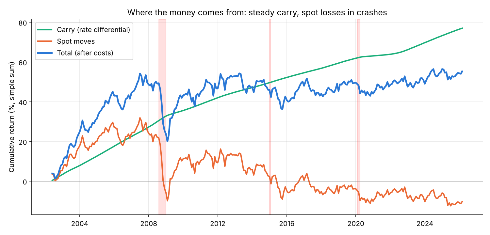
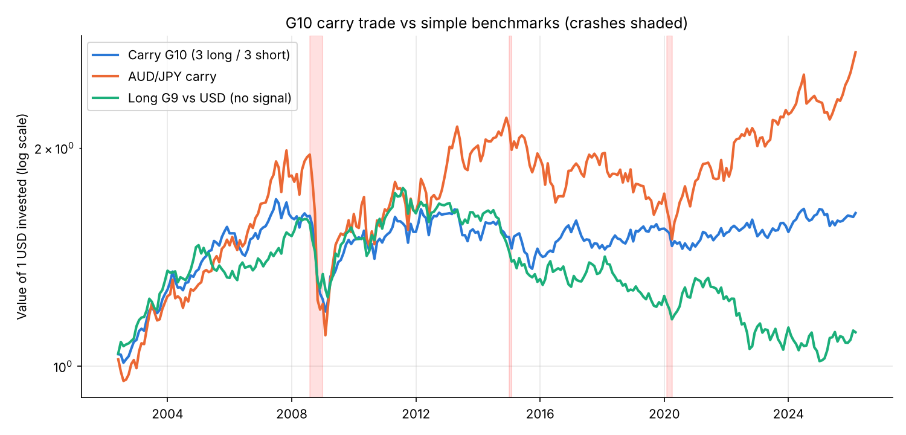
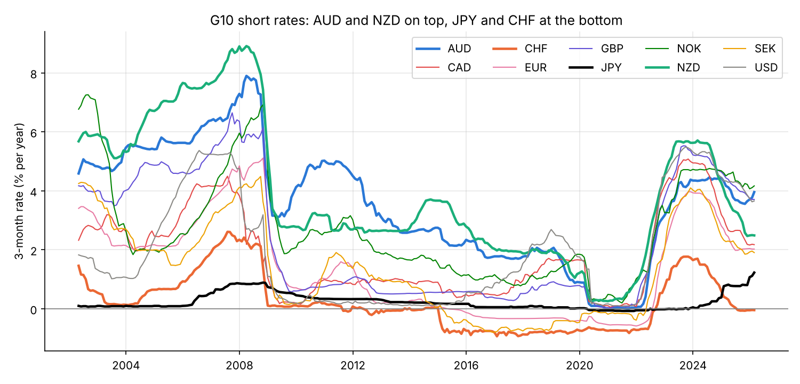
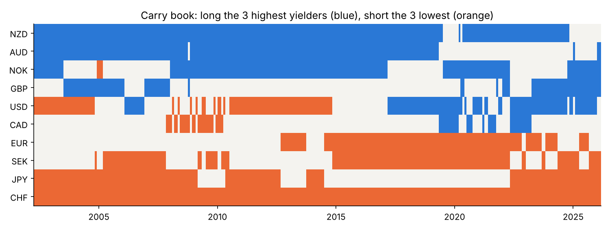
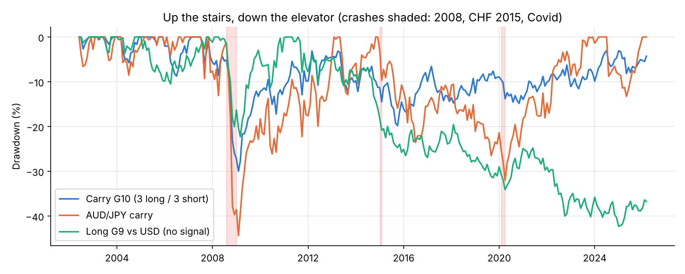
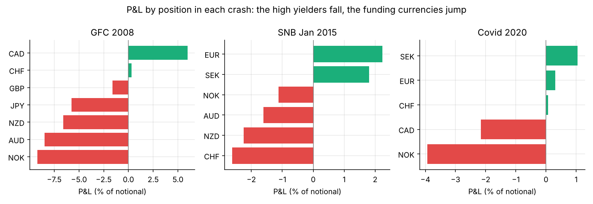
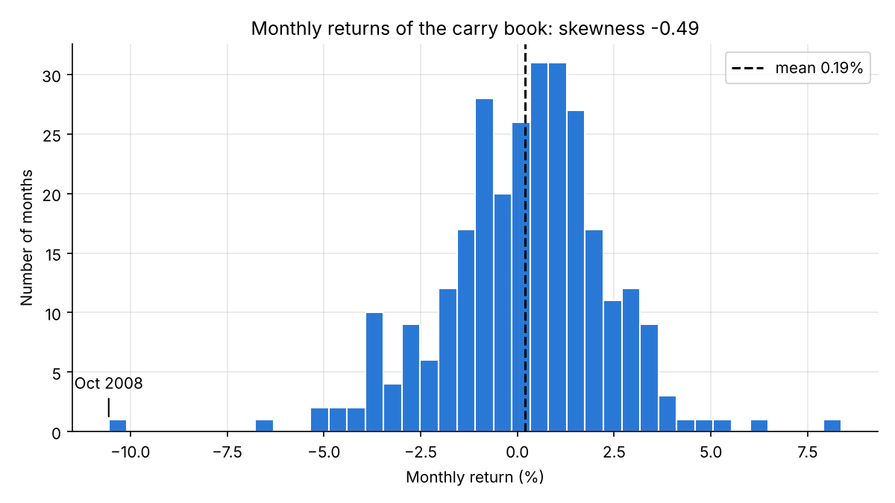
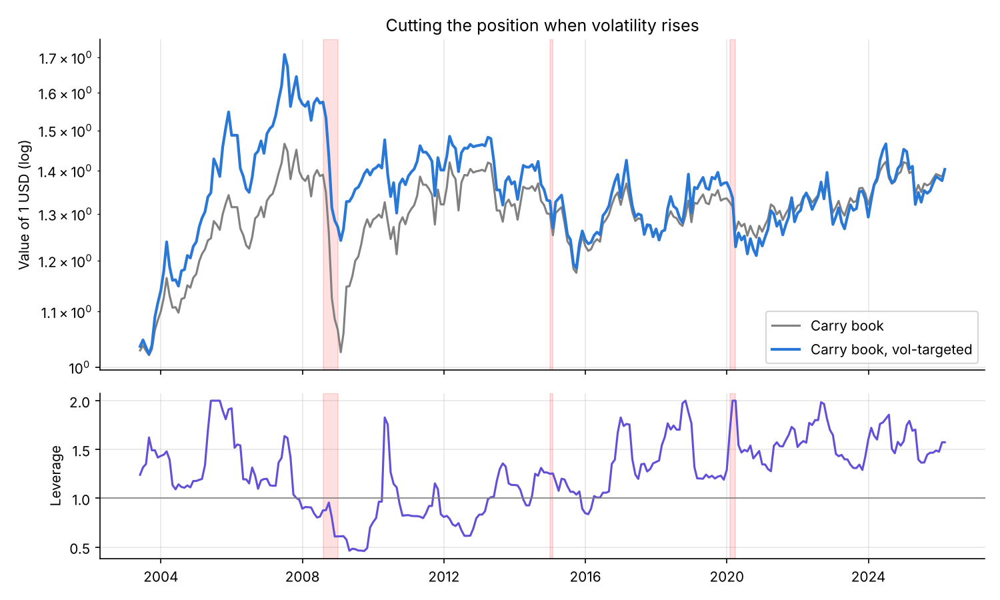

# G10 FX Carry Trade: Backtest and Crashes

The carry trade is one of the oldest trades in FX: borrow in a currency with low
interest rates, lend in a currency with high rates, and collect the difference.
Textbook theory (uncovered interest parity) says the high-yield currency should
depreciate by exactly the rate gap, so the trade should earn nothing on average.
In practice it does earn money most of the time, then gives a large part back in
a few violent months. Traders call it "picking up pennies in front of a steamroller".

I wanted to measure both sides on real data: how much the carry pays, and how
much the crashes cost (2008, the Swiss franc in January 2015, Covid in 2020).

*Over 24 years the rate differential earned about 3.2% a year, very regularly
(green). Spot moves (orange) added money until 2008, then took it back in a few
months. The trade lives on the carry and dies by the spot.*

## The strategy

At the end of each month I rank the 10 G10 currencies (AUD, CAD, CHF, EUR, GBP,
JPY, NOK, NZD, SEK, USD) by their 3-month interest rate.

- **Long** the 3 highest yielders, **short** the 3 lowest, equal weights.
- The positions are 1-month FX forwards, rolled every month. Under covered
  interest parity, a forward earns the spot move plus the rate differential,
  so each month's return splits cleanly into a **carry** part (known in advance)
  and a **spot** part (the risk).
- The book is dollar neutral (as much long as short), so I do not take a view on
  the USD itself. The USD is just one of the 10 currencies and can be long or short.
- Cost: 2 bp of notional per monthly roll (a typical bid/ask on a G10 1-month
  forward), on the whole book, which is about 0.5% a year.

I compare it with two simple benchmarks: the classic **AUD/JPY** carry pair, and
being **long the 9 other currencies against the USD** with no signal at all (to
check that the carry book is not just a bet against the dollar).

## Data

Only free public data, monthly, from **April 2002 to February 2026** (286 months):

- **Spots**: Federal Reserve H.10 daily noon rates (via FRED), last fixing of each month.
- **Short rates**: OECD 3-month interbank rates (via FRED, series `IR3TIB01`).

The window is set by the rates: the OECD 3-month yen rate starts in April 2002,
and the euro and sterling series stop in January 2026. `scripts/download_data.py`
downloads everything again.

## Results

| | Carry G10 (3/3) | AUD/JPY | Long G9 vs USD |
|---|---|---|---|
| Annual return | 2.1% | 4.3% | 0.5% |
| Volatility | 7.4% | 13.4% | 8.1% |
| Sharpe ratio | 0.31 | 0.38 | 0.10 |
| Skewness | −0.49 | −1.14 | −0.11 |
| Max drawdown | −30% | −44% | −42% |
| Worst month | −10.6% (Oct 2008) | −24.1% (Oct 2008) | −8.9% (Oct 2008) |

**1. The carry is real, but it is not a free lunch.** The book earned the rate
gap (+3.2% a year) but lost on spot (−0.4% a year) and costs (−0.5%). The
returns have a negative skew: many small gains, a few large losses. The long-USD
benchmark makes almost nothing, so the carry return does come from the ranking,
not from a dollar bet.

**2. Two very different periods.**

| | 2002-2007 | 2009-2026 |
|---|---|---|
| Annual return | 8.7% | 1.6% |
| Sharpe ratio | 1.28 | 0.26 |
| Carry earned per year | 4.8% | 2.6% |
| Spot per year | +4.3% | −0.3% |

Before 2008, high-yield currencies did not depreciate, they *appreciated* (the
"forward premium puzzle"): investors got the carry *and* the spot. After 2008,
central banks cut rates close to zero almost everywhere. With less dispersion
between rates, there is less carry to collect (see the rate chart below), and the
spot no longer helps.

**3. Who is in the book.** NZD was long 91% of the time and AUD 72%; CHF was
short 100% of the time and JPY 58%. The USD moved from funding currency (2002-2004,
2010-2014) to high yielder (2017-2020, 2022-2025), which the dollar-neutral ranking
picks up automatically.

### The crashes

| Episode | Carry book | Spot part | Carry part | Biggest losses |
|---|---|---|---|---|
| GFC, Aug-Dec 2008 | **−23.3%** | −27.6% | +2.3% | long NOK (−9.2%), long AUD (−8.5%) |
| SNB removes the EUR/CHF floor, Jan 2015 | −3.6% | −3.8% | +0.2% | short CHF (−2.6%), long NZD (−2.2%) |
| Covid, Feb-Mar 2020 | −4.7% | −5.0% | +0.4% | long NOK (−3.9%), long CAD (−2.2%) |

- **2008 is the textbook carry crash.** When risk appetite collapsed, everyone
  unwound at the same time: at the worst point AUD and NZD had lost about 30%
  against the dollar and NOK 27%, while the yen, the main funding currency,
  rallied. AUD/JPY lost 24% in October 2008 alone and 44% peak to trough. The
  carry earned over those five months (+2.3%) was nothing against a −27.6% spot move.
- **January 2015** was a jump, not a slow crash: the SNB removed the 1.20 floor
  and the franc jumped by more than 15% within minutes. In a diversified book where CHF is
  one short among three, the month cost 3.6%. A trader running a leveraged short
  CHF position lost much more (the retail broker Alpari UK went bankrupt that week).
  Month-end data also understates it: by the end of January the franc had given
  back part of the jump.
- **Covid** hit the commodity currencies (NOK, CAD) as oil collapsed. The loss
  was smaller because the yen was not in the short leg at that time and the
  rebound came quickly.

### Can a simple risk filter help?

I tried scaling the position to a constant 8% volatility, using the last
12 months of realised vol (the scale for month t only uses data up to t-1).

| Same period (May 2003 - Feb 2026) | Carry G10 | Vol-targeted |
|---|---|---|
| Annual return | 1.5% | 1.5% |
| Sharpe ratio | 0.24 | 0.21 |
| Max drawdown | −30.0% | −30.7% |

It does not help. The 2008 crash came after a calm period, so the filter was
still fully invested when it started, and it cut the position *after* the losses,
missing the 2009 rebound. A slow backward-looking vol filter is too late for a
crash that starts with a jump. Better crash signals would be forward-looking:
FX implied volatility, the VIX, or risk reversals, which price the crash risk
before it happens.

## What I take from it (sales view)

- The carry trade pays you to **sell crash insurance**: steady income, with a
  negative skew. For a client, that has to be said upfront: a 2% a year carry can
  disappear in one month.
- The carry is locked in the forward price, so it is known on day one. The risk is
  all in the spot. That is why carry products (high-yield deposits, dual currency
  investments, TARFs on EM currencies) are sold in calm markets and hurt in
  risk-off episodes.
- Carry needs **dispersion of interest rates**. When all central banks are at zero
  there is little to collect. With rates back to 2-5% since 2022, the trade became
  interesting again: AUD/JPY returned about 8% a year on average in 2023-2025.
- Diversification helps: 3 longs against 3 shorts has a third less drawdown than
  AUD/JPY alone, half the volatility and a much less negative skew, for a similar Sharpe.

