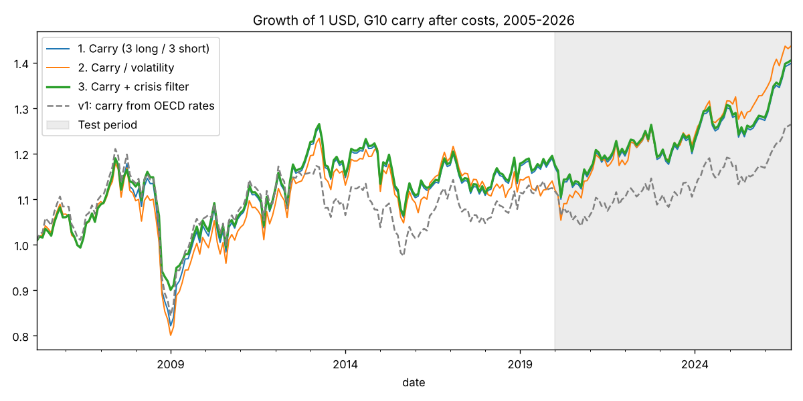
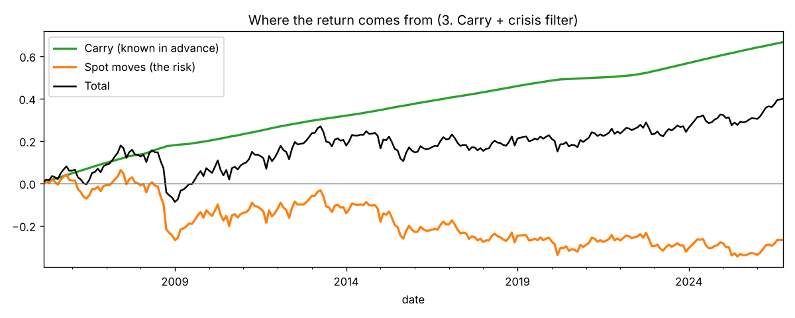
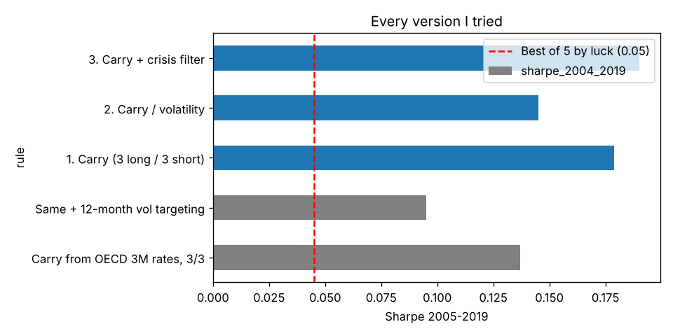
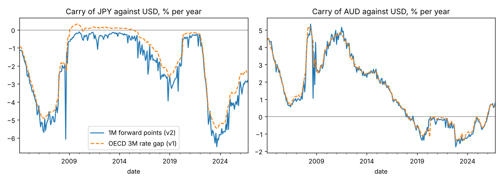
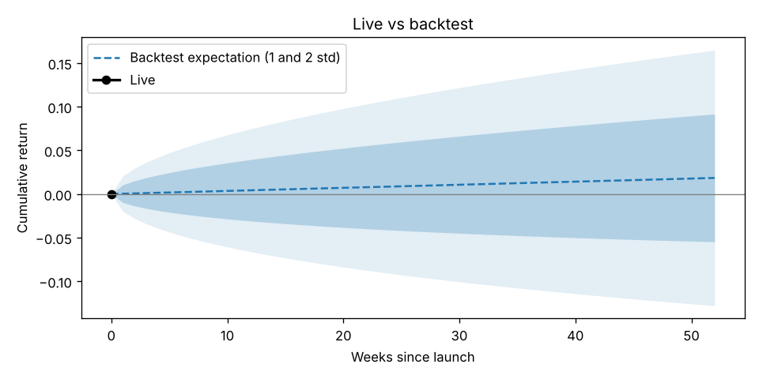

# G10 FX Carry: 21-Year Backtest and Live Track Record

I test the oldest trade in FX: **buy the currencies that pay a high interest rate, sell the
ones that pay a low rate, and collect the difference**. Theory (uncovered interest parity) says
the high-yield currencies should fall by exactly the rate gap, so the trade should earn
nothing. In practice it earns a small, steady carry and gives part of it back in a few violent
months ("picking up pennies in front of a steamroller").

This is version 2 of the project. Version 1 (October 2026) measured the carry with OECD
interest rates. Version 2 reads it from **real 1-month forward points (Bloomberg)**, which is
what a trader actually pays or earns on a forward.

Three questions drive the project:
1. **Is the Sharpe real, or did I find it by luck?** I answer with the t-stat and the Deflated Sharpe Ratio, I log every version I try, and I keep 2020-2026 aside until the end.
2. **Is it a new source of return, or just equity risk in disguise?** I regress it on the US stock market.
3. **Does it survive in real time?** From 27 November 2026, I run a 1 million USD paper book and publish it every weekend ([LIVE.md](LIVE.md)).

| Rule 3, after costs | 2005-2019 (choice) | 2020-2026 (test) | 2005-2026 |
|---|---|---|---|
| Return per year | 1.5% | 2.5% | 1.8% |
| Volatility | 8.0% | 5.4% | 7.3% |
| **Sharpe** | **0.19** | **0.46** | **0.25** |
| t-stat | 0.7 | 1.2 | 1.2 |
| Max drawdown | -24% | -6.5% | -24% |
| Skew | -0.8 | -0.7 | -0.8 |

## 1. The strategy

At the end of each month:
- **Signal**: the 1-month carry of each G10 currency against the USD, read from its forward. If the forward EUR/USD is above the spot, the EUR pays less than the USD, so holding EUR costs money.
- **Book**: rank the 10 currencies (AUD, CAD, CHF, EUR, GBP, JPY, NOK, NZD, SEK and the USD, whose carry is 0). Long the 3 best, short the 3 worst, one third each, through 1-month forwards. When the USD is in the top 3 (46% of the months), the book is simply long USD.
- **Timing**: the carry known at the end of month t sets the book held in month t+1. No look-ahead.
- **Costs**: 2 bp per USD traded (bid/ask of a G10 forward). The whole book rolls every month, so costs take about 0.5% per year.

**Why should it work?** High-rate currencies are risky: they belong to commodity exporters
(AUD, NZD, NOK) and fall when the world economy slows. Investors want a premium to hold them.
Low-rate currencies (JPY, CHF) are safe havens that rise in a crisis. So the carry is a reward
for selling crash insurance, and the crashes are the price.

## 2. Data

- **Forward points**: Bloomberg HP screen, 1-month forward points of the 9 pairs (EURUSD1M, USDJPY1M...), month-end, February 2004 to October 2026. Checked against the Bloomberg statistics box (average, high and low): all 9 series match to 0.01, except SEK whose average is off by 0.03 points out of -71 (one cell probably misread, negligible).
- **Spots**: Federal Reserve H.10 rates from FRED, month-end. Free.
- **Version 1 carry**: OECD 3-month interbank rates from FRED. Free.
- **US stock market**: Ken French Data Library. Free.
- **Live**: Bloomberg FRD screen (spot and 1-month points of the 9 pairs), one photo per pair every Friday.
- Raw Bloomberg data is not published (licence).

## 3. Backtest



I write three rules in my plan before running anything:
1. **Carry**: 3 long / 3 short, equal weights.
2. **Carry / volatility**: same, but ranked on carry divided by the currency's 12-month volatility.
3. **Carry + crisis filter**: rule 1, cut in half when the average G10 volatility is above its 90th percentile (measured on the past only).

| 2005-2026, after costs | 1. Carry | 2. Carry / vol | 3. Crisis filter | v1 (OECD rates) |
|---|---|---|---|---|
| Sharpe 2005-2019 | 0.18 | 0.14 | **0.19** | 0.14 |
| Sharpe 2020-2026 | 0.46 | 0.63 | **0.46** | 0.38 |
| Max drawdown | -31% | -32% | **-24%** | -30% |
| Sep-Dec 2008 | -21% | -21% | **-16%** | |
| January 2015 (Swiss franc) | -6.0% | -7.8% | -6.0% | |
| March 2020 (Covid) | -5.0% | -5.0% | -5.0% | |

I pick the rule on 2005-2019 only: rule 3 wins, by a small margin. Then I open 2020-2026
once. Rule 3 earns a Sharpe of 0.46 on the test period, better than before. Rule 2 does even
better there (0.63), but I chose before looking, so I keep rule 3.

**The crisis filter** cuts the book in half in 15 months, mostly from late 2007 to mid-2009.
It brings the loss of September-December 2008 from -21% to -16%, and the max drawdown from -31%
to -24%. It is late by nature (the volatility rises after the first fall), and it does nothing
for a one-day shock like the Swiss franc in 2015.



**Where the money comes from**: the carry pays **+3.1% per year**, very regularly. Spot moves
take back **-1.2% per year** and costs **-0.5%**. The trade lives on the carry and dies by the spot.

## 4. Is the Sharpe real?

| Measure | Question | Formula | My result |
|---|---|---|---|
| Sharpe | How much return per unit of risk? | mean / std × √12 | 0.19 (2005-2019) |
| t-stat | Could the true mean be zero? | Sharpe × √years | 0.7 |
| Deflated Sharpe | Same, knowing I tried 5 versions and the returns have fat tails | Bailey and Lopez de Prado (2014) | **0.71** |

**t-stat.** With 15 years of data, a Sharpe of 0.19 gives t = 0.7, far from the bar of 2
(or 3, as Harvey, Liu and Zhu ask). Even over the full 22 years, t = 1.2. A Sharpe of 0.25
needs about 64 years of data to reach t = 2. **I cannot prove the carry premium is above zero
with G10 data since 2004.** Longer studies (Lustig and Verdelhan, 1983-2009, 30+ currencies)
can.

**Deflated Sharpe Ratio.** I count every version I ever tried, including the two of
version 1 ([`results/trials_log.csv`](results/trials_log.csv)). With only 5 trials, all close
to each other, the Sharpe the best one would show by luck is just 0.05: keeping the trial
count low is what keeps the DSR alive. The DSR is **0.71**, below the 0.95 target, mainly
because the sample is short and the skew is negative. **The rule does not pass.**



## 5. Is it just equity risk?

I regress the monthly P&L on the US stock market (excess return), with Newey-West t-stats:

| Alpha per year | t-stat | Beta to stocks | t-stat | R² |
|---|---|---|---|---|
| -0.6% | -0.5 | **0.25** | 6.1 | 26% |

Once I take out the stock market, nothing is left. In the 27 months where US stocks fall by more
than 5%, the carry book loses 1.9% on average. The carry is a cousin of being long equities
and short volatility: it pays in calm markets and loses when risk appetite collapses. A fund
that already holds equities gets little diversification from it.

## 6. Why version 2? Forward points vs OECD rates



Under covered interest parity, the forward points should equal the interest rate gap. They do
not, exactly:
- **The gap mostly goes one way**: the forward makes most non-USD currencies pay less than the OECD rates
  say, by 46 bp per year for JPY, 37 bp for NOK and 34 bp for EUR. This is the **cross-currency
  basis**: since 2008, banks pay a premium to borrow USD through FX swaps, and the forward
  carries that premium. Between 2014 and 2019, the OECD rates show a JPY carry of about zero,
  while the forward shows -0.5% to -1%.
- **The ranking changes**: the two measures are 93% to 99% correlated, yet the two versions hold
  exactly the same 6 currencies in only 45% of the months.
- **The result improves a little**: same rule, same months, Sharpe 0.24 with forward points
  vs 0.18 with OECD rates. The real forward is the right measure because it is what I trade.

## 7. Live track record

The rules are frozen in [RULES.md](RULES.md). Every week I take a photo of the Bloomberg FRD
screen for the 9 pairs at the Friday close. On the last Friday of the month, the code ranks the currencies on the
carry of that photo and sets the new book. The rule is mechanical: anyone can redo the ranking
from the published carry numbers, so I cannot pick the book after seeing the market. Over the
weekend I compute the P&L. Before Monday 9:00 Paris time I commit. At each rebalance, I add a
short letter to investors.

| Since launch (27 Nov 2026) | |
|---|---|
| Weeks | 0 |
| Cumulative P&L | - |
| NAV (start 1,000,000 USD) | - |
| Worst week | - |

**First live book (photos of Friday 27 November 2026):** long AUD (+0.7% carry per year),
GBP (-0.1%) and USD; short CHF (-5.2%), JPY (-3.6%) and SEK (-2.7%). 333,333 USD per leg,
crisis filter off. It is almost the same book as the backtest at the end of October (NOK out,
GBP in).



The cone shows what the backtest expects over the first year (mean, 1 and 2 standard
deviations). One point is added every week. After a few weeks a t-stat means nothing. The real
question is whether the live P&L stays inside the cone.

**Latest week and full history:** [LIVE.md](LIVE.md).

## How to run

```
pip install -r requirements.txt
python scripts/download_spots.py   # once: FRED spots and OECD rates
python backtest.py                 # backtest, statistics and charts in results/
python live.py positions           # on the last Friday of the month: the new book
python live.py week                # every weekend: P&L of the week
```

References: Lustig and Verdelhan (2007), *The Cross Section of Foreign Currency Risk Premia*.
Brunnermeier, Nagel and Pedersen (2008), *Carry Trades and Currency Crashes*. Menkhoff, Sarno,
Schmeling and Schrimpf (2012), *Carry Trades and Global Foreign Exchange Volatility*. Du,
Tepper and Verdelhan (2018), *Deviations from Covered Interest Rate Parity*. Bailey and Lopez de
Prado (2014), *The Deflated Sharpe Ratio*. Harvey, Liu and Zhu (2016).
